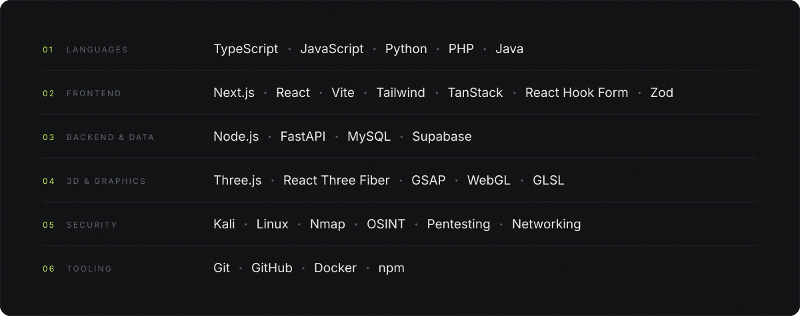
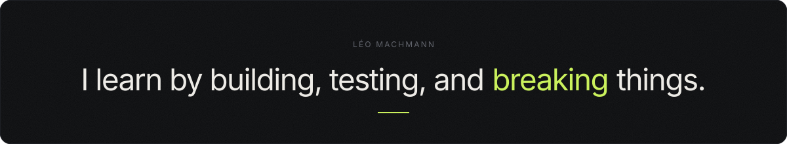

 

**[Elyra Studio ↗](https://github.com/ElyraStudio)** &nbsp;·&nbsp; **[LinkedIn ↗](https://www.linkedin.com/in/leonardo-machmann-francisco/)** &nbsp;·&nbsp; **[Portfolio ↗](https://elyras.vercel.app/)**

 

## About

I'm a developer focused on building **modern, performant and security-conscious web applications**.

My work sits between frontend engineering, full-stack development, interactive experiences and cybersecurity: business platforms, SaaS products, 3D/WebGL interfaces and security tooling.

Right now I'm building products and client solutions through **Elyra Studio**.

 

## Stack

 

## Selected work

### Aegis
Domain security scanner. Give it a domain and it grades its security posture from 0 to 100, explains every finding and tells you how to fix it.

- **TLS**: certificate chain and validity, accepted protocol versions, weak ciphers, key size, OCSP stapling
- **Headers & cookies**: HSTS, CSP quality, clickjacking protection, Permissions-Policy, server version leaks, `Secure` / `HttpOnly` / `SameSite`
- **Email & DNS**: SPF (including the 10-lookup limit), DMARC, DKIM, MTA-STS, TLS-RPT, CAA, DNSSEC
- **Known vulnerabilities**: detected technologies cross-referenced with OSV, NVD and CISA KEV
- **Attack surface**: subdomains from Certificate Transparency, subdomain takeover, internal IPs leaked in public DNS
- **Reputation**: Spamhaus, SURBL, Google Safe Browsing, URLhaus
- **Active tests**: exposed `.env` / `.git` / backups and internal service ports, **only after the owner proves domain ownership** (DNS TXT or `.well-known` token, HMAC-signed, no database)

Critical findings cap the score no matter what else passes, so an exposed `.env` can never hide behind a good TLS setup. It also tracks score history, diffs between scans and certificate deadlines, and produces a printable report with prioritized fixes.

Built to be secure itself: SSRF protection with IP revalidation on every connection and redirect (against DNS rebinding), per-request CSP nonces, ReDoS-safe technology detection, scan time budgets and per-IP rate limiting. 
`Next.js 16` `React 19` `TypeScript` `Tailwind 4` &nbsp;→&nbsp; [Live ↗](https://aegis-ten-zeta.vercel.app/) · [Code ↗](https://github.com/Leonard0MF/aegis)

### Podocare Flow
Practice management system for podologists: scheduling, patient records and clinical history. Anamnesis forms are sent through a unique public link (shareable via WhatsApp), so patients fill everything in on their phone with no account. Backend and database on Supabase, with data protected by Row Level Security. 
`React` `TypeScript` `TanStack Router` `TanStack Query` `Supabase` `Tailwind` &nbsp;→&nbsp; [Live ↗](https://podocare-theta.vercel.app) · [Code ↗](https://github.com/Leonard0MF/podocare-flow)

### Client websites · Elyra Studio
Conversion-focused websites for small businesses. 
[Elyra ↗](https://elyras.vercel.app/) · [Espaço Lazuli ↗](https://espaco-lazuli.vercel.app/) · [Lita Podóloga ↗](https://lita-podologa.vercel.app/) &nbsp;·&nbsp; `Next.js` `React` `TypeScript` `Tailwind`

 

## Security labs

**Mini Honeypot** &nbsp;`Python` 
Simulates and logs unauthorized network intrusion attempts in a controlled environment. &nbsp;→&nbsp; [Code ↗](https://github.com/Leonard0MF/MINY-HONEYPOT)

**OSINT Automation Tool** &nbsp;`Python` 
Automates public data gathering and intelligence analysis workflows. &nbsp;→&nbsp; [Code ↗](https://github.com/Leonard0MF/osint-base)

All security work is done in controlled environments or on authorized targets only.

 

## Currently building

- **Aura Máxima**: immersive 3D portfolio with an Earth-from-space scene, custom ocean and atmosphere shaders, day/night lighting, procedural stars and scroll-driven storytelling. `Next.js` `Three.js` `R3F` `GLSL` `GSAP` *(in progress)*

 

  

