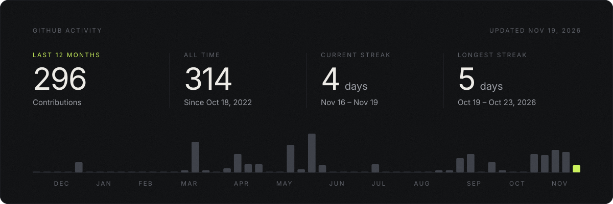

 

**[LinkedIn ↗](https://www.linkedin.com/in/leonardo-machmann-francisco/)** &nbsp;·&nbsp; **[Aegis ↗](https://aegis-ten-zeta.vercel.app/)**

 

## About

Full-stack developer at **BUMP**, where I work on our internal systems and own code review and application security. Outside work I build security tooling and play with 3D/WebGL.

 

## Stack

 

## Projects

### Aegis
Domain security scanner that grades a site from 0 to 100 and tells you how to fix each finding: TLS, headers, cookies, email/DNS, known CVEs (OSV, NVD, CISA KEV), subdomain takeover and reputation. Active tests only run after the owner proves domain ownership, and the scanner itself is hardened against SSRF and DNS rebinding. 
`Next.js 16` `React 19` `TypeScript` `Tailwind 4` &nbsp;→&nbsp; [Live ↗](https://aegis-ten-zeta.vercel.app/) · [Code ↗](https://github.com/Leonard0MF/aegis)

### Podocare Flow
Practice management system for podologists: scheduling, patient records and anamnesis forms sent by link, so patients fill them in on their phone with no account. Supabase backend with Row Level Security. 
`React` `TypeScript` `TanStack Router` `TanStack Query` `Supabase` `Tailwind` &nbsp;→&nbsp; [Live ↗](https://podocare-theta.vercel.app) · [Code ↗](https://github.com/Leonard0MF/podocare-flow)

 

## Security labs

**Mini Honeypot** &nbsp;`Python` 
Dependency-free TCP honeypot that logs the source IP, port and payload of every connection, including empty port-scan probes. Payloads are escaped so attackers can't forge log lines, with log rotation, per-connection timeouts and a cap on concurrent connections. &nbsp;→&nbsp; [Code ↗](https://github.com/Leonard0MF/mini-honeypot)

**OSINT Toolkit** &nbsp;`Python` 
CLI that collects public data from free APIs: IP geolocation, ASN and proxy/VPN/datacenter detection, WHOIS and DNS records, and GitHub account profiles. Interactive menu or direct commands with JSON output, plus unit tests that mock every API call. &nbsp;→&nbsp; [Code ↗](https://github.com/Leonard0MF/osint-base)

All security work is done in controlled environments or on authorized targets only.

 

## Currently building

**Aura Máxima** *(in progress)*: immersive 3D portfolio with custom WebGL shaders and scroll-driven storytelling.

 

  

